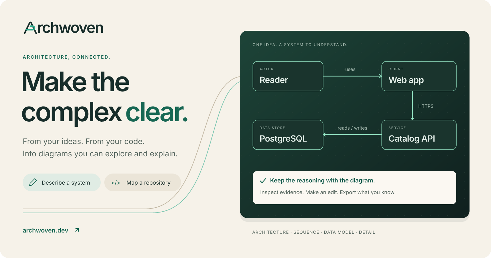
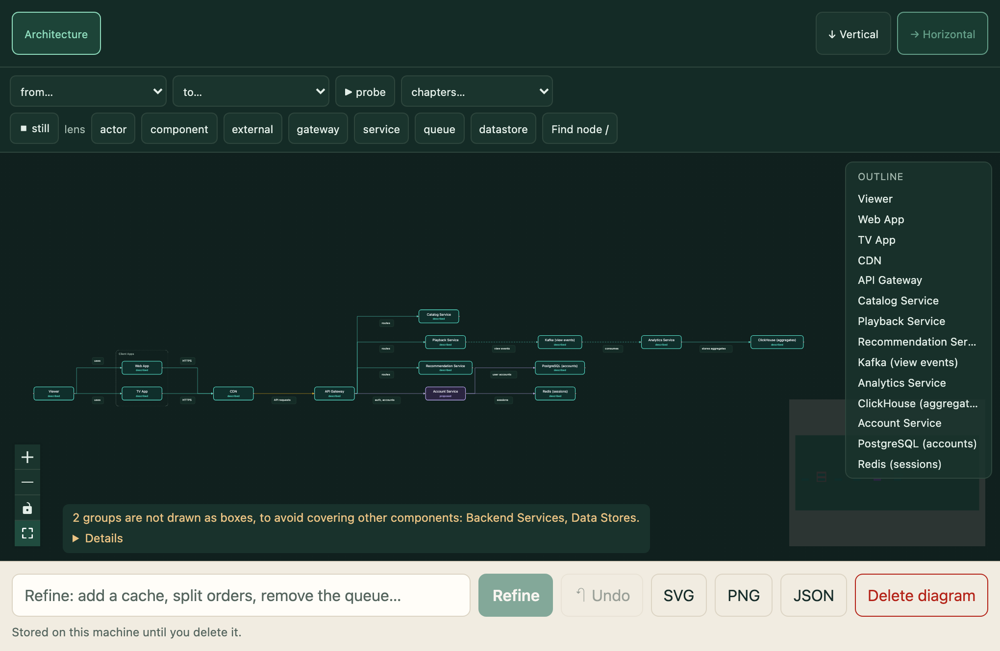
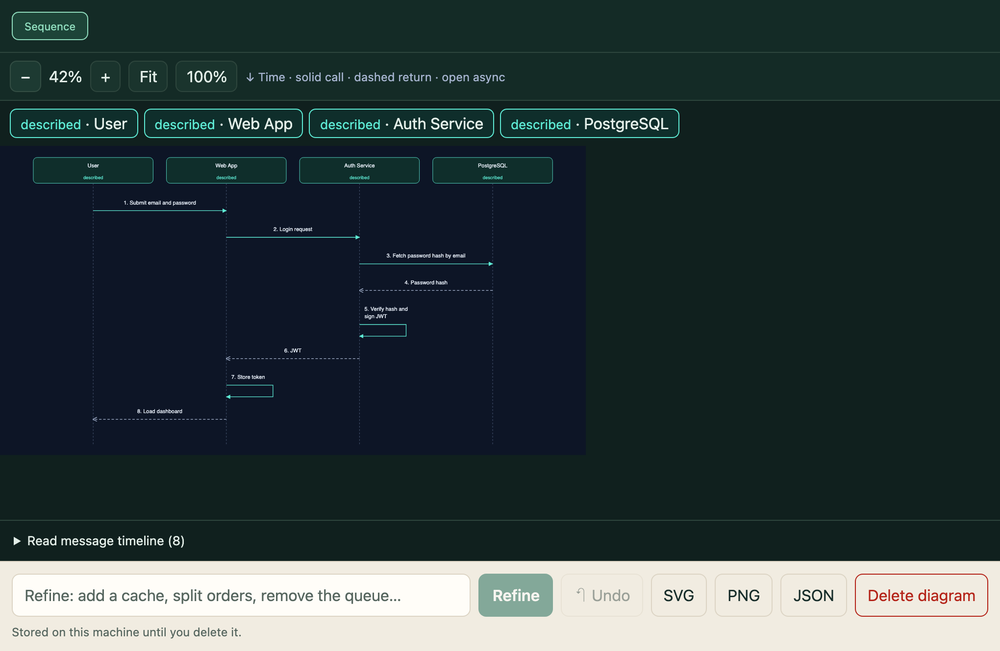
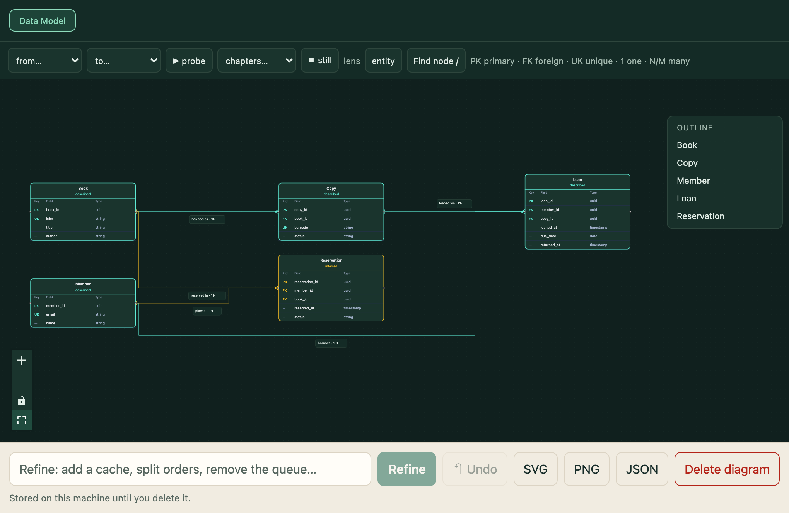
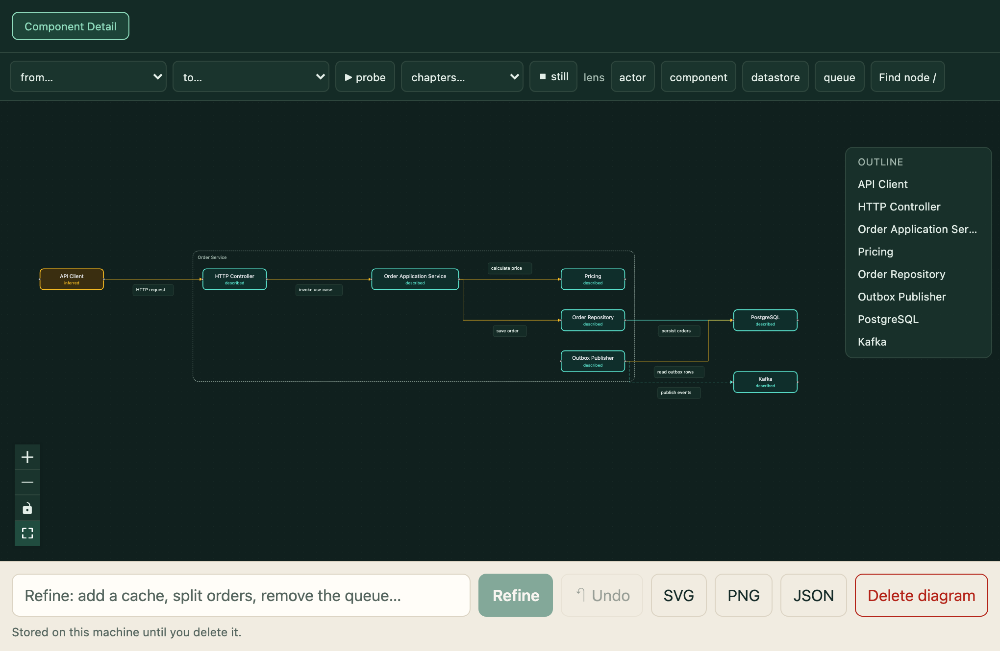
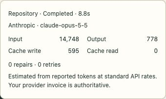

# Archwoven

**Turn ideas and code into architecture you can explore, question and explain.**

[](https://archwoven.dev)

<p align="center">
  <a href="https://archwoven.dev/workspace"><strong>Open workspace ↗</strong></a> &nbsp;·&nbsp;
  <a href="#run-locally">Run locally</a> &nbsp;·&nbsp;
  <a href="docs/deployment.md">Self-host</a> &nbsp;·&nbsp;
  <a href="docs/testing.md">Engineering &amp; evaluation</a>
</p>
<p align="center">
  <a href="https://github.com/ManankumarThakkar/archwoven/actions/workflows/ci.yml"></a>
  <a href="LICENSE"></a>
  <a href="#run-privately"></a>
</p>

## 🎬 See it in motion

https://github.com/user-attachments/assets/680a96de-f04e-4d02-bd7b-84b31f2ad3b8

A 32-second tour: describe a streaming platform, follow requests and events, then inspect a repository connection at its source. **The same film as the [live landing page](https://archwoven.dev/#example).**

## 🎯 Who it’s for

| You want to… | Archwoven helps you… |
|---|---|
| Understand an unfamiliar codebase | Map source modules, inspect evidence and see what remains unknown. |
| Plan or review a system | Turn a description into a diagram, follow a request and refine the design. |
| Explain what you’ve learned | Keep an editable model and export diagrams for onboarding, docs or a design discussion. |

## 🧭 Four ways to understand a system

| Architecture | Sequence |
|---|---|
| [](docs/assets/architecture.png) | [](docs/assets/sequence.png) |
| **The big picture.** Components, services and connections. | **The interaction.** Who calls whom, and in what order. |
| **Data model** | **Component detail** |
| [](docs/assets/data-model.png) | [](docs/assets/component-detail.png) |
| **The data.** Entities, keys and relationships. | **One level deeper.** Responsibilities inside a component. |

Screenshots of the actual viewer using [recorded real-provider outputs](docs/assets/README.md). Click an image to inspect it at full size.

## ⚡ Start with an idea or a repository

1. **Bring context.** Open the [workspace](https://archwoven.dev/workspace). Describe a system and choose a view, or paste a public GitHub repository URL.
2. **Explore.** Find a component, inspect its evidence, follow a route or step through a guided chapter. Repository evidence links to files at the analysed commit.
3. **Make it yours.** Arrange and rename elements, refine in words and undo changes. Download **SVG / PNG** for sharing or **JSON** to reopen and keep editing.

Try: *“An order API checks inventory, charges a payment provider, saves the order in PostgreSQL and publishes an event.”*

No account is needed. Hosted AI has shared limits; viewing, available diagrams and downloads remain usable when new AI calls pause.

## 📚 Keep the knowledge, not just the picture

- **Inspectable provenance:** components and connections distinguish described, source-supported, inferred and proposed claims. Coverage gaps stay visible.
- **Portable work:** JSON preserves the editable system model; SVG and PNG fit into READMEs, handovers and architecture reviews.
- **Clear retention:** hosted recovery copies last **24 hours after the last change**. This browser keeps up to **20 diagrams** until deleted or site data is cleared. Download what you want to keep.

Spring Boot and FastAPI receive framework-aware extraction. Other repositories receive a bounded source-module and import map. Source code is read without executing it; static imports do not establish runtime topology.

## 💸 Know what each AI task used

Open **Last task** to see the provider and model, input/output tokens, cache writes/reads, repairs, retries and estimated API cost. Missing usage is marked incomplete.



This live repository task reported **16,121 tokens · $0.0775 estimated · 0 repairs · 0 retries**. It is one example, not a fixed price. Estimates use reported usage; the provider invoice is authoritative.

Public hosting reserves each paid attempt’s maximum cost before sending it, against visitor, network, daily, monthly and annual caps. Repairs and retries are included. Ollama runs show **Local inference** with no external API charge; hardware and electricity are not measured. [Spending controls →](docs/deployment.md#initialize-spending-limits)

<a id="run-locally"></a>
## 🚀 Run locally

Requires **Node.js 24**, **pnpm 12.9.1** and Git.

```bash
git clone https://github.com/ManankumarThakkar/archwoven.git
cd archwoven
corepack enable
pnpm install --frozen-lockfile
```

If Corepack is unavailable, install the pinned package manager with `npm install --global pnpm@12.9.1`.

### Run privately

Start [Ollama](https://ollama.com) first (the desktop app, or `ollama serve` in another terminal), then:

```bash
cp .env.local.example apps/web/.env.local
ollama pull gpt-oss:20b
pnpm dev
```

Open **http://127.0.0.1:3000/workspace**. The default model downloads about 13 GB. Set `OLLAMA_MODEL` in `apps/web/.env.local` to a model your machine can run. Local inference stays in Ollama; public repository imports still fetch GitHub. Use local-folder imports for offline repository reads. They analyse the clone’s checked-out commit, excluding uncommitted changes.

<details>
<summary>Run privately with Docker instead</summary>

```bash
docker compose up --build
# In another terminal:
docker compose exec ollama ollama pull gpt-oss:20b
```

Open http://127.0.0.1:3000/workspace. See [docker-compose.yml](docker-compose.yml) to mount local clones read-only.

</details>

<details>
<summary>Use a hosted model on your development machine</summary>

Copy `apps/web/.env.local.example` to `apps/web/.env.local`. Set these values with your own provider key:

```dotenv
ARCHWOVEN_MODE=hosted
ANTHROPIC_API_KEY=your-key
```

Run `pnpm dev`. Calls are billed to your provider account. The chosen model appears in Last task; configure it with `ARCHWOVEN_HOSTED_MODEL`. Restart after env changes. Public Vercel hosting also requires shared Redis jobs and an initialized spending ledger: follow the [deployment guide](docs/deployment.md).

</details>

## 🛠️ Built to be checked

A description or extracted repository becomes **typed JSON → schema and graph checks → bounded repair → deterministic rendering**. One model powers the views and exports; structural validity is not a guarantee of architectural correctness.

**Stack:** Next.js / React / TypeScript · Zod · React Flow / ELK · tree-sitter · Anthropic / Ollama · Redis / SQLite.

```bash
pnpm build
pnpm test
pnpm typecheck
pnpm bench:selftest
```

CI checks production packaging, dependency security, shared Redis jobs, spending and privacy boundaries, and Docker/Compose recovery. [Browser coverage, recorded results and limitations →](docs/testing.md)

<details>
<summary>Repository map</summary>

| Path | Purpose |
|---|---|
| `apps/web` | Landing page, workspace and API routes |
| `packages/model` | System-model schema and validation |
| `packages/llm` | Inference, usage accounting and egress guards |
| `packages/extract` / `packages/ingest` | Static extraction and safe repository reads |
| `packages/jobs` | Jobs, retention and spending ledgers |
| `benchmarks` / `probes` | Evaluation harnesses, fixtures and ground truth |

</details>

## 🤝 Contribute

[Report a bug](https://github.com/ManankumarThakkar/archwoven/issues/new) with reproduction steps and the expected result. For code changes, run the checks above and include a screenshot when changing the UI. Keep secrets and personal repository data out of issues and commits.

Built by [Manan Thakkar](https://www.linkedin.com/in/mananthakkar20/) · [GitHub](https://github.com/ManankumarThakkar) · [⭐ Star Archwoven](https://github.com/ManankumarThakkar/archwoven)

[MIT](LICENSE) · [Third-party notices](NOTICE.md)
